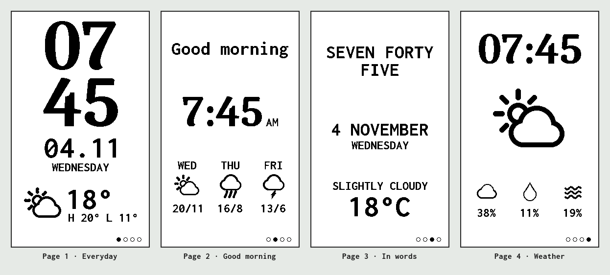
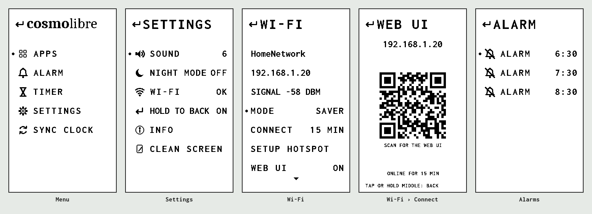
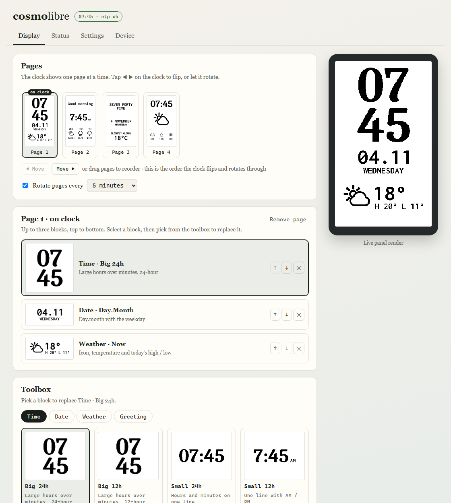

# CosmoLibre

**Open, local-first replacement firmware for the Cosmo II e‑paper clock.**

CosmoLibre brings a Cosmo II back to life without the manufacturer's cloud. It
joins your Wi‑Fi, keeps time over NTP, fetches weather from Open‑Meteo (no
account needed), and is set up from a web page served by the clock itself — or
from a menu on the clock using its touch pads.

The Cosmo II was created by Art of Sum and crowdfunded on Kickstarter:
[Cosmo II — the modern timepiece](https://www.kickstarter.com/projects/artofsum/cosmo-ii-the-modern-timepiece).



*Four example pages, three widgets each — flip between them with the touch pads
or let the clock rotate through them. Every image here is drawn by the
firmware's own code.*

---

> [!WARNING]
> **This is unofficial, alternative firmware.** It is not affiliated with,
> endorsed by, or supported by Art of Sum or the makers of the Cosmo II.
>
> **No warranty is provided.** Flashing third-party firmware can leave your
> device unusable and replaces the original software. You do this entirely at
> your own risk.
>
> **Back up your original firmware first** (see [Back up your clock](#1-back-up-your-clock)).
> With a full flash dump you can always put the clock back exactly as it was.

---

## Why this exists

I bought a Cosmo II and loved the object — but not the experience of owning it.
It never reliably held on to my Wi‑Fi credentials, and getting help took a long
time. Then the manufacturer's cloud service went down. Everything about the
clock was configured through that service, so I was left with a device I
couldn't set up, stuck showing the wrong time zone.

The hardware is lovely and deserves better than becoming e‑waste. CosmoLibre is
my attempt to give it a second life: no cloud, no account, nothing that can be
switched off from somewhere else.

I hope it's the spark for a **community effort to bring back the original
features**. One honest caveat, based on my understanding of how the original
worked: the clock was set up through a cloud‑hosted web page that linked to it
by its device ID and pushed configuration — and firmware updates — down to it.
So the editor and much of the logic lived in the cloud, and the clock itself
only did part of the work. Now everything has to run on the device — an ESP8266
with about 80 KB of RAM and 4 MB of flash — so what can come back is limited
mostly by what fits and runs on the clock, not by what can be
reverse‑engineered. Forks, issues and pull requests are very welcome — see
[Contributing](#contributing).

## How this was made

There's a USB port on the clock's ESP8266 board (a CH340 USB‑serial chip),
which made this possible without special tools:

1. **Opened the device** and identified the boards and chips — the ESP8266, the
   e‑paper panel and its controller, the audio amplifier, the touch pads and
   the battery charger.
2. **Dumped the full 4 MB flash** over that USB port with `esptool`, keeping an
   untouched backup.
3. **Inspected the dump** with `binwalk` and custom scripts: flash layout,
   embedded web pages, layout definitions, sounds, strings.
4. **Probed the hardware** with small test firmwares to confirm which pins the
   display, touch pads and speaker use.
5. **Wrote new firmware from scratch** — none of the original code is reused —
   working with AI coding assistants ([Cursor](https://cursor.com) and
   [Claude](https://claude.ai)).

### Use of AI tools

To be upfront: much of this project was built with AI assistance. I directed
the work — the goals, the hardware exploration, design decisions and testing on
a real clock — while AI coding assistants (Cursor and Claude) wrote most of the
code and documentation, and helped analyse the firmware dump.

It's tested on my own Cosmo II as it develops, but it hasn't had a
line‑by‑line expert review. Treat it as a hobby project: read the code before
relying on it, and please open an issue if you spot something wrong.

## Features

**On the display**
- Widgets modelled on the original app's "Add Element" catalogue:
  - **Time** — big stacked digits (24h / 12h), single line (24h / 12h), or in
    words (`NINE TWENTY NINE`, `FIVE PAST TEN`, `TEN O'CLOCK`)
  - **Date** — `04.11 / WEDNESDAY`, `11.04 / WEDNESDAY`, `4 NOVEMBER`
  - **Weather** — now (icon, temperature, high/low), temperature & day,
    description (`SLIGHTLY CLOUDY / 29°C`), details (cloud, rain chance,
    humidity), big icon, three‑day forecast
  - **Greeting** — GOOD MORNING / Good morning / good morning
- Up to **4 pages** of up to 3 widgets each; flip between them with the touch
  pads or let them **rotate** every 1–60 minutes
- A clean face: the bottom status line only appears when something needs
  attention (no Wi‑Fi, no time yet) — or always shows the IP, if you prefer
- Gentle on the panel: per‑widget partial refreshes, with an hourly full
  refresh to clear ghosting

**On the clock (touch pads)**
- Hold the middle pad for a menu laid out like the original —
  **Apps** (pages & rotation), **Alarm**, **Timer**, **Settings** and
  **Sync clock**
- **3 alarms** (every day / weekdays / weekends) with snooze, and a **timer**
- **Wi‑Fi › Connect** shows the web UI's address and a **QR code** to open it on
  your phone
- Wi‑Fi setup hotspot and Forget Wi‑Fi, each behind a confirm screen



**Wi‑Fi and battery**
- **Power saver** (default): Wi‑Fi is off between syncs. The clock keeps its own
  time, wakes about every 45 minutes to update the time and weather, and never
  runs the radio during a screen refresh. Choose **Always** to stay connected.
- A simple **setup page**: pick your network from a list of what the clock can
  see, type the password, done.
- If Wi‑Fi fails, the radio switches off between retries, and the status line
  shows the reason code and what the clock could see (`wifi r201 0/7` =
  network not found, seven others visible) — handy when the clock is on
  battery with no USB.

**In the browser (served by the clock — no app, no cloud)**
- **Display** — design pages from a **toolbox of blocks**, each variant shown
  as a thumbnail rendered by the clock; drag pages to reorder; presets to start
  from; a live preview of exactly what's on the panel
- **Settings** — time zone, location (search, then pick the right place),
  sync beep, show IP
- **Status** — time, weather, Wi‑Fi, uptime, free memory, firmware version
- **Device** — test beep, Wi‑Fi setup, Forget Wi‑Fi, turn the web UI off (it
  can only be turned back on from the clock)



**Under the hood**
- ESP8266 Arduino firmware built with PlatformIO
- Local JSON API (`/api/status`, `/api/config`, `/api/pages`, …); write
  requests need an `X-Cosmo` header so other websites can't drive your clock
- Settings stored on the clock, migrated automatically between firmware versions
- Weather and place search by [Open‑Meteo](https://open-meteo.com) — free, no
  API key

## Not there yet

- **Wi‑Fi on battery** is still being tested. The panel's refresh and the
  radio together draw more than the battery circuit likes; power saver is the
  current fix.
- **Air quality (VOC) and room temperature.** The original had a *Time & Air*
  app (VOC) and a *Time & Room* app (indoor temperature); indoor humidity was
  never a feature. The VOC sensor is a GY‑SGP40 (Sensirion SGP40, I²C) — an
  optional add‑on, so not every clock has one. Which pins it's wired to isn't
  known yet (probably D1/D2), and the SGP40 doesn't measure temperature, so
  where room temperature came from is still open.
  **Help wanted** — see [issue 10](https://github.com/ast0ne1/cosmolibre/issues/10).
- **Battery level** — the measuring circuit isn't understood yet.
- **Original alarm chimes** — alarms play a beep pattern for now.
- **Firmware updates from the web UI** (upload a new version over Wi‑Fi) —
  updating needs a USB cable for now.

## Hardware

What's been confirmed on a real unit:

| Part | Details |
|---|---|
| MCU | WeMos D1 mini (or clone) on a carrier board: ESP8266EX, 4 MB flash, 26 MHz crystal |
| USB serial | CH340, on the D1 mini (its micro‑USB port) |
| Display | 3.7" e‑paper, ED037TC1, 280×480, SSD1677 — GxEPD2 `GxEPD2_370_TC1` |
| Display pins | CS 15 · DC 4 · RST 5 · BUSY 16 · SCK 14 · MOSI 13 (HSPI) |
| Touch | 3 pads on top, read through A0 (left ≈ 190, middle ≈ 15) plus GPIO2 |
| Speaker | MAX98357A on the ESP8266's I²S pins: BCLK 15 · LRC 2 · DIN 3 |
| Air quality | GY‑SGP40 breakout (Sensirion SGP40, I²C 0x59) on the carrier board, an optional add‑on — SDA/SCL pins not confirmed yet: no reply on GPIO 0/2/12, so probably D1/D2, shared with the display ([issue 10](https://github.com/ast0ne1/cosmolibre/issues/10)) |
| Power | Li‑ion cell with a power switch; HW‑373 (TP4056) charger, charge‑only — the clock always runs from the cell, even on USB |

The amplifier shares GPIO15 with the display's chip select, GPIO2 with the
touch pads and GPIO3 with serial RX, so the firmware never plays sound while
drawing, and serial output can glitch during playback.

The D1 mini's pins are labelled, which helps when tracing the board:

| D1 mini pin | GPIO | Used for |
|---|---|---|
| A0 | ADC | Touch pads |
| D0 | 16 | Display BUSY |
| D1 | 5 | Display RST (probably also the SGP40's SCL) |
| D2 | 4 | Display DC (probably also the SGP40's SDA) |
| D3 | 0 | Free (I²C scan: no reply) |
| D4 | 2 | Touch pads · speaker LRC |
| D5 | 14 | Display SCK |
| D6 | 12 | Free (I²C scan: no reply) |
| D7 | 13 | Display MOSI |
| D8 | 15 | Display CS · speaker BCLK |
| RX | 3 | Speaker DIN (and serial RX) |
| TX | 1 | Serial log |

## Install

You need a USB cable, a computer and `esptool` (`pip install esptool`). To
build the firmware yourself you also need [PlatformIO](https://platformio.org)
(VS Code extension, or `pip install platformio`).

### 1. Back up your clock

Do this **before** flashing anything. It copies the entire 4 MB flash —
original firmware, its files and your settings:

```bash
esptool --port COM4 --baud 115200 read-flash 0x0 0x400000 cosmo2-original.bin
```

Use your own port (`/dev/ttyUSB0` on Linux, `/dev/cu.wchusbserial…` on macOS).
Older esptool versions are called `esptool.py` and spell the command
`read_flash`. Keep the file safe and private — it contains the manufacturer's
software and your Wi‑Fi password. To go back to the original firmware at any
time:

```bash
esptool --port COM4 --baud 115200 write-flash 0x0 cosmo2-original.bin
```

### 2. Get the firmware

**Download it (easiest):** grab `cosmolibre-<version>.bin` from the latest
[release](https://github.com/ast0ne1/cosmolibre/releases/latest). The release
notes list its SHA‑256 checksum if you want to check the download.

**Or build it yourself:**

```bash
cd firmware/cosmo
pio run
```

The web UI and the Wi‑Fi setup page (`web/`) are built into the firmware
automatically.

### 3. Flash

With the downloaded file — it's the complete image, written at address `0x0`:

```bash
esptool --port COM4 --baud 115200 write-flash 0x0 cosmolibre-0.1.0.bin
```

Or, if you built it yourself:

```bash
pio run -t upload --upload-port COM4
```

Either way your saved Wi‑Fi is kept.

### 4. Connect to Wi‑Fi

On first boot (or after Forget Wi‑Fi) the clock opens a hotspot called
**CosmoLibre**. Join it from your phone; the setup page opens by itself (or go
to **http://192.168.4.1**). Pick your **2.4 GHz** network, enter the password
and tap Connect. The clock restarts and joins.

### 5. Open the web UI

In power saver the clock's Wi‑Fi is usually asleep, so wake it first: hold the
middle pad › **Settings › Wi‑Fi › Connect**. The clock shows its address and a
QR code — scan it, or open **http://cosmolibre.local/**. It stays online for
15 minutes, and for as long as the page is open.

## Using it

| On the clock | Does |
|---|---|
| Tap ◀ / ▶ | Previous / next page |
| Hold ● | Open the menu |
| In the menu: ◀ / ▶ | Move up / down |
| In the menu: tap ● | Select |
| In the menu: ↰ (top) then tap ● | Back |
| In the menu: hold ● | Back (can be turned off: Settings › Hold to back) |
| Alarm ringing: tap any pad | Stop |
| Alarm ringing: hold ● | Snooze 9 minutes |

The full on‑clock behaviour is described in [docs/device-ux.md](docs/device-ux.md).

## Contributing

Issues, forks and pull requests are welcome. Especially valuable:

- **VOC / temperature sensor** — the VOC chip is a GY‑SGP40 (SGP40, I²C 0x59);
  still needed: which D1 mini pins it's wired to (probably D1/D2, shared with
  the display), and where room temperature comes from, since the SGP40 doesn't
  measure it. A continuity
  check or a capture of the original firmware's air‑quality screen would settle
  both ([issue 10](https://github.com/ast0ne1/cosmolibre/issues/10))
- **Battery level** and charging state
- Playing the **original chimes**
- **Firmware updates from the web UI** — upload a new version over Wi‑Fi
  instead of a USB cable
- More widgets in the spirit of the original

### Work without a clock

`firmware/cosmo/preview/` runs the web UI and the clock's screen on your
computer. It compiles the firmware's real drawing and menu code, so what you
see is what the panel shows, pixel for pixel. You need Python 3 and a `g++`
compiler on your PATH (plus `pio pkg install` once, to fetch the libraries):

```bash
cd firmware/cosmo
python preview/preview_server.py    # http://localhost:8377 — web UI + virtual pads
python preview/run_tests.py         # settings and menu tests
```

`preview/make_readme_images.py` regenerates the images in this README.

### Where things live

| Path | What |
|---|---|
| `firmware/cosmo/src/main.cpp` | Start‑up, screen refresh scheduling, wiring |
| `firmware/cosmo/src/hal/Face.cpp` | Widget drawing + line icons |
| `firmware/cosmo/src/hal/Ui.cpp` | Touch menu, pages, alarms, timer (no hardware access, so it runs in the preview) |
| `firmware/cosmo/src/hal/WebUI.cpp` | JSON API + embedded web page |
| `firmware/cosmo/src/hal/Settings.cpp` | Stored settings + migrations |
| `firmware/cosmo/src/hal/Net.cpp` | Wi‑Fi join, power saver, setup hotspot, NTP |
| `firmware/cosmo/src/hal/Weather.cpp` | Open‑Meteo client |
| `firmware/cosmo/include/hal/Widgets.h` | Widget catalogue (IDs are stored — append only) |
| `firmware/cosmo/web/index.html` | The web UI |
| `firmware/cosmo/web/portal.html` | The Wi‑Fi setup page |
| `firmware/cosmo/scripts/make_fonts.py` | Turns the fonts in `fonts-src/` into display fonts |
| `docs/device-ux.md` | How the clock behaves (pads, menu, Wi‑Fi) |

## Licence

CosmoLibre is free software under the **GNU General Public License v3.0** —
see [LICENSE](LICENSE). You can use, change and share it; if you distribute a
modified version, it must stay open under the same licence.

The display fonts are made from **Caladea** and **Inconsolata**, both under the
**SIL Open Font License 1.1** (`firmware/cosmo/fonts-src/`). The bitmap fonts
generated from them (`firmware/cosmo/include/fonts/`) stay under that licence.

## Disclaimer

Cosmo II is a product of its respective owners; the name is used only to
describe compatibility. CosmoLibre contains none of the original firmware's
code or assets. It is provided "as is", without warranty of any kind — see the
warning at the top.
